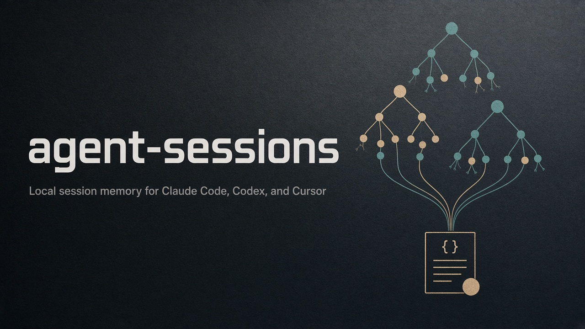

# agent-sessions

<p align="center">
  
</p>

<p align="center">
  <strong>Local session memory for Claude Code, Codex, and Cursor.</strong><br/>
  Export transcripts, recover forked/spawned families, pin hard constraints, and build auditable handoffs — without uploading your chats.
</p>

<p align="center">
  <a href="https://github.com/alimoradi296/agent-sessions/blob/main/LICENSE"></a>
  <a href="https://www.python.org/downloads/"></a>
  <a href="docs/privacy.md"></a>
  <a href="https://github.com/alimoradi296/agent-sessions"></a>
</p>

<p align="center">
  
</p>

Formerly `claude-session-exporter`. Canonical repo: [alimoradi296/agent-sessions](https://github.com/alimoradi296/agent-sessions).

**Status:** `0.3.0` source-installable CLI. Transcript formats and hooks depend on your installed agent version.

## Why developers use it

- **Stop losing constraints across agent turns.** `family` turns parent/fork/spawn links into a cited digest with continuation signals, pin templates, and optional one-command handoff bundles.
- **Search your own history offline.** Grep-friendly Markdown plus `sessions.json` for machines. No cloud index.
- **Keep evidence honest.** Pins quote exact dialogue with source coordinates. Audits check coverage. Ready never means “verified true.”

Privacy is non-negotiable: analysis runs locally with the Python standard library and does not upload transcripts. Generated files can still contain private text — keep them out of Git. Read the [privacy contract](docs/privacy.md).

[Sample export](#try-a-sample-export) · [Family digest](docs/family-digest.md) · [Continuity example](docs/continuity.md) · [Workspace](docs/workspace.md) · [Roadmap](roadmap.md)

## Quick start (synthetic only)

```bash
git clone https://github.com/alimoradi296/agent-sessions.git
cd agent-sessions
python -m venv .venv && source .venv/bin/activate
python -m pip install -e .
python examples/demo.py
python examples/family_digest_demo.py --output-dir /tmp/agent-sessions-family-mvp
agent-sessions family synthetic-family-child -d /tmp/agent-sessions-family-mvp/exports --profile strict \
  --bundle-out /tmp/agent-sessions-family-mvp/bundle --audit-family-bundle
```

Those commands invent sessions. They do not read your agent history or install hooks.

## Headline workflow

```text
private exports  →  family digest + signals  →  requirements pins  →  handoff bundle + audit
```

```bash
# After you export to a private directory (never commit this path):
agent-sessions family <session-id> -d /path/to/private-exports --profile balanced \
  --require-signal-kind scope_boundary \
  --bundle-out /path/to/private-bundle --audit-family-bundle
```

Also available: cited claim extraction, topic/`resume` workspaces, captured-file restoration, archive doctor, selective reconciliation, and Obsidian export. Details below.

<details>
<summary><strong>Also included</strong> (expand)</summary>

- Recover complete captured `Add File` bodies and exact-base Codex patch updates; deletions become tombstones
- Distinguish confirmed success, confirmed failure, and unknown tool execution in restore manifests
- Save a topic once and rebuild with `agent-sessions resume <topic>` in a private workspace
- Assistant-oriented `handoff suggest` proposals remain unaccepted until you pin them
- Bundled [continuation skill](docs/continuation-skill.md) for assistants that must keep citations

</details>

## Try a sample export

Requirements: Python 3.10 or later. After the [quick start](#quick-start-synthetic-only) install:

```bash
python examples/demo.py
agent-sessions search "retry" -d demo-output
agent-sessions stats -d demo-output
```

The demo writes synthetic files under `demo-output/` (`sample-session.md`, `SESSION_INDEX.md`, `sessions.json`). It does not read your agent history.

### Inspect a forked or spawned family

```bash
python examples/family_digest_demo.py --output-dir /tmp/agent-sessions-family-mvp
agent-sessions family synthetic-family-child -d /tmp/agent-sessions-family-mvp/exports
```

See [session family digest](docs/family-digest.md) for signal filters, `--requirements-out`, `--bundle-out`, `--audit-family-bundle`, profiles, and `--require-signal-kind` gates.

## Reuse a handoff topic

```bash
agent-sessions init --archive /path/to/private-exports
agent-sessions topic add cache-review --query "example cache"
agent-sessions topic search cache-review "discovery publish"
```

Pin the intended evidence from a search result:

```bash
agent-sessions topic pin cache-review --id scope --session synthetic-scope --section 2 \
  --unit paragraph --quote "Discovery only. Do not implement or publish."
agent-sessions resume cache-review
```

Replace the synthetic source reference with the intended local evidence.
Topics save archive paths, requirements, and limits in a private workspace outside Git checkouts.
`resume` rebuilds a local handoff and reports review blockers. It starts no agent.
`resume --print` emits handoff text only when all readiness gates pass.
Requirement packs render selected evidence directly, with citations and review notes.
Their manifests report excerpt characters separately from framing, review, and citation characters.
`topic history` and `topic changes --diff` show captured revisions and their differences.
Earlier ready captures remain historical references and never replace a failed current pack automatically.
Repeatable `--project` selectors on `topic add` or `topic set` bound the topic by exact recorded working directories and project slugs.
This prevents unrelated sessions from supplying excerpts or review candidates. The manifest shows exclusions and missing metadata.
See [the workspace guide](docs/workspace.md) for changed limits and candidate-specific review notes.

## Supported Agents

| Agent | Source Location | Hook Support | Token Tracking |
|---|---|---|---|
| Claude Code | `~/.claude/projects/<slug>/*.jsonl` | Stop hook (auto) | Yes |
| Codex | `~/.codex/sessions/YYYY/MM/DD/*.jsonl` | Stop hook (auto) | Yes |
| Cursor | `~/.cursor/projects/<slug>/agent-transcripts/` | hooks.json | No (not in JSONL) |

## Export your sessions

Use the source installation in the sample procedure above.
The CLI reads the agent directories in the table. Export one session first:

```bash
agent-sessions export claude <session-id> --dry-run
agent-sessions export claude <session-id> -o ./exports
```

Replace `<session-id>` with an existing session ID.
The dry run prints the proposed destination and metadata without exporting files.
Review the output before a bulk export or hook installation.

### Install the Claude Code Stop hook (automatic export on every session end):

```bash
agent-sessions install claude
```

### Install the Cursor stop hook:

```bash
agent-sessions install cursor
```

### Install the Codex Stop hook (requires a version with Stop hook support):

```bash
agent-sessions install codex
```

Codex and Cursor installation writes user-level configuration in `~/.codex/hooks.json` or `~/.cursor/hooks.json`.
The installer preserves unrelated hook entries and backs up each existing file before changing it.
Repeated installation keeps one exporter entry. Cursor installation migrates this exporter's old `agent-end` entry to `stop`.

The generated launcher pins the current Python interpreter and package location.
It works outside the checkout without an activated environment or a matching `python3` on `PATH`.
Reinstall the hook after moving the package or removing its Python environment.
Hook installation currently supports POSIX systems.

Preview the setup or choose another private export directory:

```bash
agent-sessions install cursor --dry-run
agent-sessions install codex --dry-run
agent-sessions install cursor --output /path/to/private-exports/
```

Automatic hooks default to `~/.agent-sessions/exports/`. They do not select a project's `docs/sessions/` directory.
Each successful invocation writes one JSON object, `{}`, to stdout. Export diagnostics stay off stdout.
Failures produce a nonzero exit status and a diagnostic on stderr. The hook does not request another agent turn.
Cursor payloads use `conversation_id`. Codex payloads use `session_id`.
Supported JSONL transcript paths identify the source directly. Other path hints fall back to session discovery.
Codex exports still merge resumed segments before writing.

Cursor reloads saved hook configuration. If it does not load, restart Cursor. See the [Cursor hook reference](https://prod.cursor.com/docs/hooks).
Codex requires review and trust for new or changed non-managed hook definitions. Review the exporter with `/hooks`.
See the [Codex hook reference](https://learn.chatgpt.com/docs/hooks).

Direct launcher tests establish parsing, import resolution, export, and stdout behavior.
They do not prove that an agent application loaded and triggered the hook.
Generated launchers, backups, configuration, and smoke reports contain local paths. Keep these files outside public repositories.

## Usage

### Export a single session

```bash
agent-sessions export claude <session-id>
agent-sessions export codex <session-id>
agent-sessions export cursor <session-id>

# Dry run — see what would be exported without writing
agent-sessions export claude <session-id> --dry-run
```

### Bulk export all sessions

```bash
# All agents
agent-sessions bulk -o ~/my-sessions/

# One agent
agent-sessions bulk --agent claude -o ~/my-sessions/

# One project
agent-sessions bulk --agent claude --project example-project -o ~/my-sessions/

# Limit session dates and record a status for each discovered source file
# --until is exclusive. Cursor dates use file modification time.
agent-sessions bulk --since 2026-02-01 --until 2026-03-01 \
  --coverage -o /path/to/private-exports/
```

Codex exports merge files with the same metadata session ID before writing a transcript.
Identical records across files count once. Repeated records within a file remain intact.
The same merge applies to single-session export, hooks, and source-based distillation.

The optional `coverage.json` records each source file as `exported`, `empty`, `outside_period`, or `error`.

Coverage format version 2 adds `record_counts` for each parsed source file:

- `records`: nonblank JSONL lines, including malformed JSON.
- `blank_lines`: blank lines, counted separately.
- `handled`: recognized records, including metadata and messages with no exportable text.
- `ignored`: known records intentionally excluded, such as reasoning or sidechain messages.
- `malformed`: invalid JSON, non-object records, or invalid shapes detected by the parser.
- `unsupported`: unknown event types, subtypes, roles, or content blocks.

Each nonblank line counts in one category. Malformed records are skipped. A record with an unsupported
content block can still contribute recognized text or tools. These counts do not measure lost messages
or validate every nested field. Codex counts describe each physical file before resumed-file overlap
is removed. Counts remain available for empty sessions and sources outside the requested date range.
Reports include counts without raw lines, transcript text, or unknown event names.

Bulk export prints a warning when malformed or unsupported records occur. Its exit code remains zero
if export succeeds; unreadable sources still cause exit code 1. `doctor` reports record coverage
warnings with counts and exit code 1. Known ignored records alone do not cause coverage warnings.
Read failures produce an `error` entry and a nonzero exit status.
Multiple exported source files can contribute to one session.
Coverage applies to discovered main transcripts. Child-agent transcript discovery is planned.
Date limits use the session start date, or the estimated date for undated Cursor transcripts.
They do not select individual turns from older sessions resumed within the period.

### Concurrent exports and interrupted writes

Session exports hold one OS lock per output directory while they read and update indexes.
This protects cooperating local writers from losing each other's index entries.
Standalone renderer writes use the same lock.

The default wait is 10 seconds per export. Use `--lock-timeout` to change the wait:

```bash
agent-sessions export codex <session-id> --lock-timeout 20 -o /path/to/private-exports/
agent-sessions bulk --lock-timeout 20 --coverage -o /path/to/private-exports/
```

A value of `0` makes one lock attempt without waiting.
A lock timeout or storage error produces exit code `1` with a diagnostic message.
Invalid indexes stop the export before it replaces any transcript or index.
Bulk export stops on a storage error. Earlier successful exports remain available.

The exporter writes and syncs temporary files in the output directory before it replaces any destination.
It replaces each destination atomically, with `sessions.json` last.
Coverage reports also use the lock and atomic replacement.
On POSIX systems, replacement files have owner-only permissions.

Atomic replacement applies to each file separately. It does not create a transaction across all three export files.
A crash between replacements can leave complete files from different export attempts.
Run `doctor` after an interrupted export. Then retry the affected export to restore consistency.

The OS releases the lock after process termination.
The `.agent-sessions.lock` file stays in place. Keep it in place because deleting it can separate competing writers onto different locks.
A killed process can leave unused `.agent-sessions-*.tmp` files. Exports and indexes do not load these files.
The concurrency and interruption tests use synthetic data on the local POSIX environment. Windows lock behavior needs separate runtime checks.

### Reconcile missed or changed exports

```bash
agent-sessions reconcile --dry-run --json
agent-sessions reconcile
agent-sessions reconcile --agent codex -o /path/to/private-exports/
```

Reconciliation parses local Claude, Codex, and Cursor sources with the current parsers.
It merges resumed Codex files before comparison.
It compares transcript content, JSON metadata, and each Markdown index row.
Only missing or different session exports are replaced. Existing entries without available sources remain in place.
Unchanged transcripts and indexes keep their contents and modification times.
The scan reads every discovered source, so large archives can take time.

The default destination is `~/.agent-sessions/exports/`, regardless of the working directory.
A dry run creates no directories, locks, or reports. Its results can change during concurrent exports.
A real run holds the export lock throughout the scan and writes a private `reconcile.json` report.
Reports contain source paths, session IDs, statuses, and error types. They contain no conversation text.
Each successful run replaces the previous report.

Exit code `1` indicates a source, storage, or index error. Source errors appear in the report, while other readable sources can still export.
A storage error stops the run. Earlier exports remain available, and the previous report can be stale.
Absent agents are skipped unless `--agent` explicitly selects one.
Sources that change during parsing are deferred with an error. A later run reads them again.
Malformed records that parsers skip are not yet counted in these reports.

A retry can restore differences from an interrupted replacement when the source and both indexes remain readable.
Invalid indexes stop reconciliation before export replacement. A missing index in an existing archive also requires restoration first.
Run `doctor` to inspect the archive before restoring an index from a private backup.
Reconciliation does not delete exports, infer lost history, run hooks, or enable a schedule.

For an optional hourly schedule, see [the scheduling guide](docs/reconciliation.md).

### Check archive health

```bash
agent-sessions doctor -d /path/to/private-exports/
agent-sessions doctor --agent codex -d /path/to/private-exports/
agent-sessions doctor --json -d /path/to/private-exports/ > /tmp/doctor-report.json
```

`doctor` reads sources, transcripts, indexes, and hook configuration. It does not repair files, create export directories, or run hooks.
Without `-d`, it inspects `~/.agent-sessions/exports/` without creating that directory.

The checks cover:

- Missing exports and source files newer than their Markdown exports.
- Differences between current parser counts and exported message counts.
- Missing transcripts, duplicate JSON entries, and inconsistent transcript metadata.
- Missing, duplicate, or orphan entries in the Markdown index.
- Invalid hook configuration and missing Python or shell scripts referenced by hook commands.

Each missing export refers to the selected export directory. An export can exist in another directory.
The source scan uses the current parsers and can take time for a large archive.
Modification times detect likely stale exports. They do not establish content integrity.

Exit code `0` means that inspection found no warnings or errors. Exit code `1` means that it found at least one.
An absent agent directory is informational unless `--agent` explicitly selects that agent.
An absent hook configuration is informational because manual export remains available.

Hook inspection covers global Claude settings, global Codex hooks, and global Cursor hooks.
Use `--project-dir /path/to/project` to also inspect that project's `.cursor/hooks.json`.
An exporter reference proves only that configuration text mentions the exporter. Hook execution remains unverified.
Reports contain local paths and session IDs. Keep these reports outside public repositories.

### Search across sessions

```bash
agent-sessions search "authentication"
agent-sessions search "cache retry" -d ~/my-sessions/ --json
agent-sessions search "cache retry" --agent codex --role assistant --limit 20
agent-sessions search "cache retry" --project example-project --since 2026-02-01 --until 2026-03-01
agent-sessions search "retry cache" --match any
agent-sessions search "AttributeError" --view evidence --role user --json
agent-sessions index -d ~/my-sessions/
```

Search ranks conversation passages with SQLite FTS5 and BM25.
Each result includes an exact text slice, session ID, section number, source hash, and date provenance.
The default dialogue view excludes tool payloads, code blocks, instruction blocks, commentary, and analysis.
Use `--view evidence` for raw rendered messages, including code, tracebacks, tool payloads, and phase-tagged text.
Evidence hits use message numbers and exact source character offsets rather than cleaned handoff section numbers.
They remain unverified source material and cannot establish that a supplied command was executed.
See [evidence search and its comparison](docs/evidence-search.md) for citations and limits.
Titles alone do not supply passage matches.

The default query requires all words in a passage, in any order.
`--match any` accepts any word. `--match phrase` requires the words in order.
Queries do not interpret regular expressions or Boolean operators.
Project filters match an exact project slug or working directory.
Date filters use recorded session dates. Estimated Cursor dates remain labeled.

Unscoped search refreshes a private `.agent-sessions-search.sqlite3` cache inside the archive.
Each declared project-selector set uses a separate hash-named cache.
The evidence view uses a separate cache with an `-evidence` suffix.
Scoped refresh reads only matching transcript files. It still reads the shared metadata index.
The refresh hashes eligible exports and updates changed passages in one SQLite transaction.
Repeated searches still read export bytes, but unchanged passages need no new parsing or indexing.
The refresh removes missing transcripts from the cache and reports them.
Unreadable sources stop retrieval instead of returning stale evidence.
The export lock coordinates this refresh with cooperating writers.
Source changes after retrieval remain possible.

The cache contains private conversation text. It uses owner-only permissions on POSIX systems.
SQLite FTS5 support is required. No extra Python package or embedding API is needed.
`index --rebuild` replaces a damaged cache without changing exports.
For a scoped cache, include the same repeated `--project` selectors on the index command.
For an evidence cache, also include `--view evidence`.
Filters do not remove private content from other existing caches or exports.

### Keep critical evidence in a handoff

```bash
agent-sessions handoff pin --id scope --session synthetic-scope --section 2 \
  --quote "Discovery only. Do not implement or publish." \
  -d /path/to/private-exports \
  -o /path/to/private-work/handoff-requirements.json

agent-sessions handoff build "example cache" \
  --requirements /path/to/private-work/handoff-requirements.json \
  -d /path/to/private-exports -o /path/to/private-work/handoff

agent-sessions handoff audit /path/to/private-work/handoff \
  -d /path/to/private-exports --json
```

Replace the synthetic source ID, section, and quote with references from your search results.
Required evidence takes priority even when it does not repeat the query.
If limits exclude a required section, the build writes a reviewable draft and exits with code `1`.
The default total handoff limit is 64,000 characters, including framing. `--max-total-chars` changes that limit.
Optional passages leave the pack before required evidence. A pack that still exceeds the total limit remains a draft.
Unrelated appended messages do not invalidate identical selected sections.
The compiler relocates a pinned section only with one complete text-and-speaker match.
Changed qualifications and ambiguous duplicates require inspection.
`handoff pin --unit paragraph --quote "exact text"` explicitly selects the complete containing paragraph from a long turn.
The pack cites its cleaned line range and states that the complete section is absent.
The complete section hash still detects changes to surrounding qualifications.

The compiler and audit also scan other indexed sessions for explicit quoted corrections, supersession, and conflicts.
An unreviewed challenge prevents readiness even when the original pinned file remains unchanged.
`handoff review` records a candidate-specific operator note without establishing correctness or granting authorization.
The audit compares bundle identity and selected evidence against current exports without changing files.
This workflow runs no quoted commands and does not grant authorization to historical requests.

See [the guide](docs/continuity.md) for limits, failure statuses, and the synthetic demonstration.

### View aggregate stats

```bash
agent-sessions stats -d ~/my-sessions/
```

Illustrative output, not a benchmark or usage report:
```
Total sessions: 142
Total messages: 3,847
Total tokens:   12,453,200
Total duration: 47.2h

  claude: 98 sessions, 8,200,000 tokens, 32.1h
  codex:  31 sessions, 3,100,000 tokens, 11.4h
  cursor: 13 sessions, 0 tokens, 3.7h
```

## Output Format

### Session files (`<session-id>.md`)

Each file contains:
- Title, agent, session ID, branch, model
- Forked-from link (if rewind/branch)
- Duration and token usage
- Session summary (from `away_summary` for Claude)
- Full conversation transcript

Codex exports include tool arguments, results, call IDs, branch metadata, and the model from turn context.
The model provider has a separate field. Tool output does not count as an assistant response.

Cursor exports preserve the project directory name as `project_slug`.
They leave the working directory unknown because the slug does not reliably encode the original path.
Cursor dates use `date_source: file_mtime`. These estimates do not establish a start time, end time, or duration.
JSON indexes, Markdown indexes, reports, and Obsidian notes preserve the date provenance.

### SESSION_INDEX.md

One searchable line per session:

```
| ID | Agent | Date | Branch | Duration | Messages | Summary | File |
|---|---|---|---|---|---|---|---|
| 021f1273… | claude | 2026-06-21 | deploy/test | 1h 23m | 12u/45a | Translating item titles... | 021f1273….md |
```

### sessions.json

Machine-readable index with full metadata, token counts, and durations. Enables programmatic queries like "show me all sessions on branch X between date A and B".

## Architecture

```
Raw JSONL (agent-specific)
    ↓
Parser (one per agent)         ← claude.py, codex.py, cursor.py
    ↓
Canonical Session dataclass    ← models.py
    ↓
Renderers (shared)             ← markdown.py, index.py, json_index.py
```

Adding a new agent = write one parser that returns a `Session`. All renderers work automatically.

## Knowledge Extraction (v0.2)

Turn transcripts into structured knowledge:

```
Raw transcript (.md)
    ↓
distill  →  {session_id}.distilled.json  (cited claims, mentions, metadata)
    ↓
link     →  sessions_graph.json           (cross-session relationships)
    ↓
to-obsidian → Obsidian notes with frontmatter
report   →  weekly markdown report
```

### Distill sessions

```bash
# All exported sessions
agent-sessions distill -d ~/.agent-sessions/exports/

# Only significant sessions (PRD work, 30m+, 5+ files, decisions)
agent-sessions distill -d ~/.agent-sessions/exports/ --significant-only

# One session
agent-sessions distill <session-id> -d ~/.agent-sessions/exports/
```

Each new `.distilled.json` contains:

- Candidate claims with types, exact quotes, speakers, source coordinates, and extraction methods.
- PRD and file mentions, plus tools and commands used.
- An unverified outcome inferred from reported-result claims.
- Legacy decision, bug, deferred-work, and question fields for compatibility.
- A significance score for filtering.

Claim types distinguish requests, proposals, decision candidates, reported blockers, reported results, proposed next actions, bug reports, deferred work, and open questions.
All extracted claims have `verification: "not_checked"`.
Words such as “verified” and “checked” remain speaker reports. They do not establish independent verification.
Requests, proposals, titles, and summaries do not establish completed work.

Version 3 adds the `claims` field. Older distilled files still load, without invented evidence references.
Re-run `distill` to produce cited claims from available sources or exports.
Reports and Obsidian notes show claim types and source references.
The extraction rules recognize a limited set of English patterns and can miss other wording or languages.
Request rules reject action-like paths, bare action headings, and common descriptive negatives. Source excerpts remain available for review.
The labeled synthetic cases test these rules. They do not establish accuracy on arbitrary transcripts.

Tool payloads, code blocks, quoted text, and common instruction blocks do not feed claim extraction.
File and PRD mentions do not prove changes or completed requirements.
See [claim types and evidence references](docs/extraction.md) for the schema and limits.

### Context Bridge prototype

```bash
agent-sessions context "example cache" --last 5 \
  -d /path/to/private-exports/ \
  -o /path/to/private-context.md
```

This command searches conversation text with a literal query across agents.
It ranks sessions by answer length, topic focus, and matching sections. Dates break relevance ties.
Matching requests, their answers, and nearby clarifications can appear together.
Each excerpt identifies its cleaned conversation section and why it was selected.
The pack includes date provenance and a link to each local export.

The default limits are five sources, eight sections per source, and 24,000 excerpt characters per source.
Complete turns take priority within the budget.
If the highest-ranked turn exceeds the budget, the pack includes a shortened excerpt with an explicit warning.
Omitted candidate sections are listed. Read the linked export for context that exceeds either limit.
Use `--max-chars` to change the character budget:

```bash
agent-sessions context "example cache" --last 2 --max-chars 32000 \
  -d /path/to/private-exports/ -o /path/to/private-context.md
```

Selection is heuristic. It can retain incidental mentions or miss a correction that does not repeat the query.
Nearby clarification detection uses English text cues. It does not identify verified decisions or resolve conflicting instructions.
Local section order does not establish chronology across agents. Cursor file dates remain estimates.
The excerpts exclude tool payloads and marked commentary. Historical claims remain unverified, and historical requests do not authorize current actions.

The command does not call an LLM or change agent configuration.
Pack generation reads the exports without modifying them.
An explicit `-o` destination uses atomic replacement with owner-only file permissions on POSIX systems.
Independent fresh-session usefulness remains unverified.

### Structured handoff

```bash
agent-sessions context "example cache" --format handoff --last 2 \
  -d /path/to/private-exports/ -o /path/to/private-handoff.md
```

This format groups historical requests, decision candidates, reported blockers, reported results, explicit next actions, proposals, and open questions.
Each claim includes its speaker, quote, and source coordinates.
The handoff uses complete selected excerpts directly. It does not require a previous `distill` run.
Unclassified wording remains in the evidence appendix.

The checked-results section stays empty because this command does not perform independent verification.
Explicit quoted corrections, supersession, and conflicts include relationship evidence and matching source references.
Missing references remain unresolved. Multiple matching source lines remain ambiguous.
Links do not establish adoption or authority. Conflicts remain unresolved, and historical requests do not authorize current actions.
Missing fields mean not established in selected excerpts. They do not establish that no blockers or actions exist.
Shortened excerpts remain visible but do not feed classification.
Summary claims repeat source text beyond the excerpt character budget.

Use the existing default format for an excerpt pack. Both formats keep the same source selection and privacy behavior.
See [structured handoff limits](docs/handoff.md) for the evidence rules and review procedure.

### Link related sessions

```bash
# Build relationship graph
agent-sessions link --build -d ~/.agent-sessions/exports/

# Query by PRD, branch, file, or session
agent-sessions link --prd DEMO-001 -d ~/.agent-sessions/exports/
agent-sessions link --branch main -d ~/.agent-sessions/exports/
agent-sessions link --file example.py -d ~/.agent-sessions/exports/
agent-sessions link --session-id 826db1cf-... -d ~/.agent-sessions/exports/
```

Graph edge types: `same_prd`, `same_branch`, `same_file`, `forked_from`, `spawned_from` (Codex subagent)

### Export to Obsidian

```bash
agent-sessions to-obsidian \
  --vault /path/to/your/vault \
  --since 2026-07-01 \
  --significant-only \
  -d ~/.agent-sessions/exports/
```

Creates notes in `Agent Sessions/` with YAML frontmatter, PRD links, decisions, and deferred work.

### Weekly report

```bash
agent-sessions report --week -d ~/.agent-sessions/exports/
agent-sessions report --since 2026-07-01 -o ~/report.md
```

## Limits and privacy

Full contract: [docs/privacy.md](docs/privacy.md).

- Commands run locally with the Python standard library. They do not upload transcript data.
- Exports can contain prompts, secrets, paths, code, and tool output. Keep them outside public repositories.
- `.gitignore` and `scripts/check_public_surface.py` are guards, not redactors. Review `git status` before every push.
- Agent transcript formats can change. Parsers match the formats implemented in this checkout.
- Cursor exports lack token usage and branch metadata in the parsed format. Missing token counts do not mean zero usage.
- Session titles, signals, and extracted outcomes are heuristics. They do not prove completion, correctness, or authorization.
- Hook installation changes local agent settings. Verify hook support in your installed agent version before installation.
- Public demos and screenshots must use synthetic data only.

```bash
python3 scripts/check_public_surface.py
```

The sample procedure verifies export, indexing, search, and family flows with synthetic data.
It does not certify every agent version or hook lifecycle.

## Project layout

```text
agent_sessions/  Python package and CLI
  parsers/       Claude Code, Codex, and Cursor readers
  renderers/     Markdown and shared indexes
  analysis/      Claims, family digests, handoffs, graphs, and reports
docs/            Command behavior, privacy contract, and assets
docs/assets/     Public README images (no private transcripts)
examples/        Synthetic demos and fixtures
scripts/         Public-surface checks
tests/           Synthetic regression checks
roadmap.md       Implemented features and remaining work
```

The current implementation lives in `agent_sessions/`.
Retired shell-script implementations remain available in Git history.
Use `agent-sessions install` for the current hook setup.

## Development

Run the synthetic regression tests:

```bash
python3 -m unittest discover -s tests -v
```

Tests generate invented transcripts in temporary directories.
Do not add real transcripts, exports, reports, or screenshots to tests or public demonstrations.
Run `python3 scripts/check_public_surface.py` before publishing commits.
